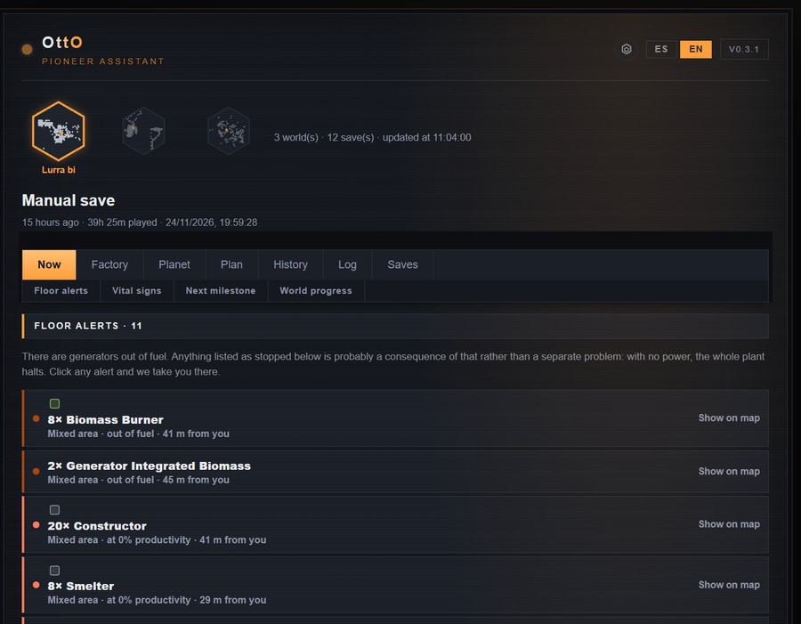
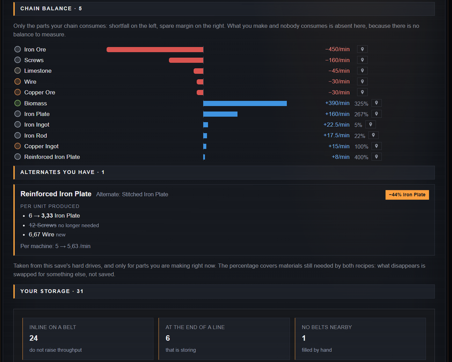
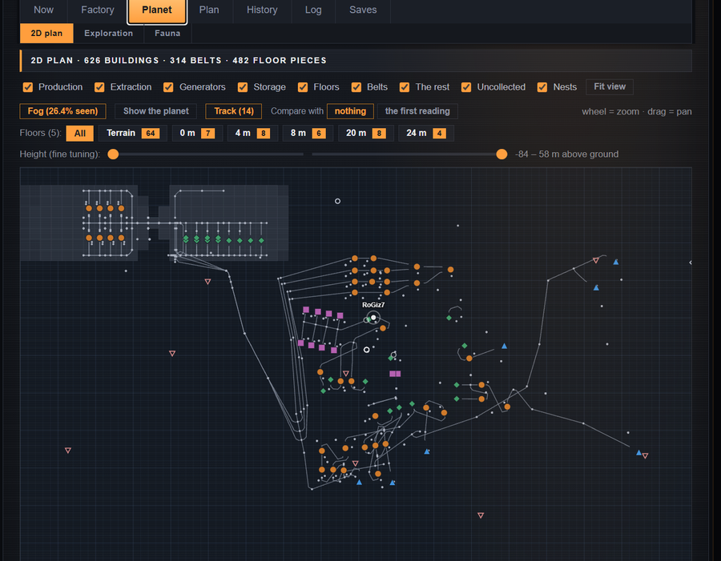
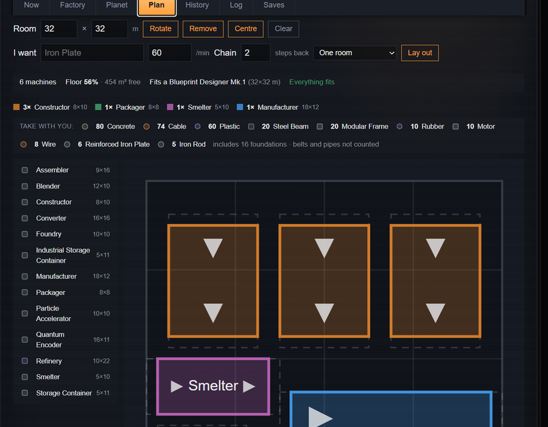
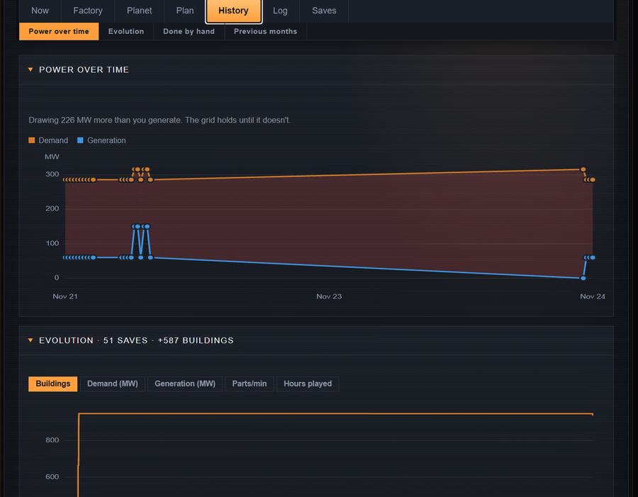

<h1 align="center">OttO</h1>

<p align="center">
  🇬🇧 <strong>English</strong> ·
  <a href="README.es.md">🇪🇸 Español</a>
</p>

<p align="center">
  A local-first, open source desktop app for <strong>Satisfactory</strong>: it reads your save
  files and tells you what you have built, how it has grown, and what is missing.
</p>

<p align="center">
  <a href="https://github.com/RoGiz7/otto-satisfactory/releases">⬇️ Releases</a> ·
  <a href="https://ko-fi.com/rogiz7">☕ Buy me a coffee</a> ·
  <a href="https://github.com/RoGiz7/FICSIT-Factory-Manager">🌐 Sister project (web)</a>
</p>

<p align="center">
  
  
  
  
</p>

> Built for the community: free, non-commercial, and not trying to compete with anyone.

OttO runs on Windows, and the whole interface is available in **English and Spanish** —
switch language from the top bar, no restart needed.

## 📸 What it looks like

<p align="center">
  
</p>

<p align="center"><em>Each world is a hexagon containing the footprint of your own factory. Below, what is asking for attention right now.</em></p>

<table>
<tr>
<td width="50%"></td>
<td width="50%"></td>
</tr>
<tr>
<td><strong>Factory</strong> — the alternates your hard drives unlocked, and what each would save on the parts you are actually making.</td>
<td><strong>Planet</strong> — your factory from above, floor by floor. It shows only what you have explored.</td>
</tr>
<tr>
<td></td>
<td></td>
</tr>
<tr>
<td><strong>Plan</strong> — lay machines out before building them, with the game's own dimensions. It tells you whether it fits a blueprint designer.</td>
<td><strong>History</strong> — how your factory has grown across every save it has seen.</td>
</tr>
</table>

## 🎯 What makes it different

Most Satisfactory tools are calculators: you type what you want to build and they tell you the
ratios. Useful, but they know nothing about *your* factory.

This one starts from your save file. It reads what you have actually built — every machine, its
recipe, its overclock — and keeps a local history across saves, so it can answer the question that
made this app exist:

> *"I came back after two weeks. What was I doing, and what do I do next?"*

Because it stores a snapshot every time you save, it can show you your factory growing over weeks,
compare what you planned against what you built, and point at the item that is actually short.

## ✨ What's in it

- ↩️ **"Resume here"** — open a world and it tells you what changed since your last save, shows your
  own note, flags current bottlenecks and points at the next milestone. The reason this app exists.
- 🔍 **Finds your saves by itself** — detects the game's save folder, groups saves by world, and
  watches the folder: save in-game and the app refreshes on its own.
- 🏭 **Factory inventory** — every machine you own, grouped by type and counted.
- ⚙️ **Real production** — the exact recipe running in each machine, including overclock, turned
  into output per minute and estimated power draw. Read from the save, not guessed from a plan.
- 🧮 **Bottleneck detector** — production minus consumption, item by item. When something is short
  it says how many machines would close the gap, and marks them in red on the map.
- ⚡ **Power balance and factory health** — estimated consumption vs generation with the margin left,
  rolled up into a 0–100 health score.
- 📈 **Evolution** — a chart of your factory over time, built from a snapshot per save.
- 🧭 **Progress** — current tier and milestones, read from the save.
- 📝 **Logbook** — notes per world, so future-you knows what past-you was in the middle of.
- 🎯 **Build plan** — set goals per machine type and watch the progress bars fill.
- 🧮 **Production calculator** — pick a target rate and get the machines, the chain and the raw
  materials. It is **tier-aware**: it only offers what that world has actually unlocked.
- 📦 **Stored materials** — what is sitting in your containers and your Dimensional Depot.
- 🔭 **Exploration** — collectables and drop pods still waiting out there, uncollected.
- 🗺️ **2D map** — a top-down plan of your factory with machines by category, conveyor belts traced
  from the save, and **automatic floor detection** so a multi-level build reads as separate levels.
- 🔒 **Read-only by design** — the app opens your saves to read them and never writes to them.

## 🗺️ Roadmap

- **Achievements and medals** — a monthly series built from your own local history: milestones hit,
  machines raised, bottlenecks cleared. Your factory's story, told back to you.
- **Compare two saves** — a diff between any two snapshots.
- **Blueprint library** — read the `blueprints` folder and show what each one costs to build.
- **Game map underlay**, zoom and pan.
- **First packaged release** — signed-ish installer and automatic updates.

## ⬇️ Install

No installer is published yet — the first release is still being prepared. For now you can build it
yourself:

```bash
git clone https://github.com/RoGiz7/otto-satisfactory.git
cd otto-satisfactory
npm install
npm run tauri dev      # run it
npm run tauri build    # build an installer
```

You will need [Node.js](https://nodejs.org/) 20+, [Rust](https://rustup.rs/) and the Visual Studio
C++ build tools. See the [Tauri prerequisites](https://v2.tauri.app/start/prerequisites/).

When releases do arrive, Windows will show a **SmartScreen** warning ("Windows protected your PC")
because the app is not signed with a certificate yet. Click **More info → Run anyway**. This is
normal for indie apps.

## 🔒 Privacy

Everything is local. The app has no server, no account and no telemetry: it reads the `.sav` files
already on your disk and stores its notes, plans and history in your own user folder. Nothing is
uploaded anywhere, and your saves are never modified.

## 🖼️ Part icons

The app can show the game's own icons next to each part. **It never ships them.** The art is Coffee
Stain's, so there is not a single one of their images in this repository or in the installer: you
extract them from your own copy of the game, drop them in a folder, and the app reads them from
your disk. Leave the folder empty and everything still works — the icons decorate, they do not hold
anything up.

Community tools commonly display these icons, and the official wiki publishes a tutorial for
extracting them while stating that the exported content is copyrighted and belongs to Coffee Stain
Studios. That practice rests on tolerance, not on a licence, and this project says so rather than
pretending otherwise. **If Coffee Stain asks us not to use their icons, the feature comes out.**

Setup and the full reasoning: [docs/ICONS.md](docs/ICONS.md). What is ours, what is theirs and
what each would cost to undo: [docs/LEGAL.md](docs/LEGAL.md).

## Releasing

The app updates itself from GitHub releases. Installers are signed and the app
verifies the signature before installing anything, so the private key never
leaves the machine of whoever publishes. Steps in
[docs/RELEASE.md](docs/RELEASE.md).

## 🙏 Credits

- **Coffee Stain Studios** for Satisfactory, for the game data it publishes in
  `CommunityResources`, and for the part icons the app can display from your own installation. That
  art is theirs; see [docs/ICONS.md](docs/ICONS.md).
- [@etothepii/satisfactory-file-parser](https://github.com/etothepii4/satisfactory-file-parser) for
  reading the save format.
- Medal icons by **Delapouite** and **Lorc**, from [game-icons.net](https://game-icons.net),
  under [CC BY 3.0](https://creativecommons.org/licenses/by/3.0/). See
  [branding/medals/NOTICE.md](branding/medals/NOTICE.md).
- Built with [Tauri](https://tauri.app/), Rust and TypeScript.
- Designed and written side by side with **Claude** (Anthropic). This project is openly
  AI-assisted: the ideas, the decisions and the testing are mine, the pair programming is shared,
  and the commits say so.

## ⚠️ Disclaimer

Satisfactory, FICSIT and their logos are trademarks of **Coffee Stain Studios**. This is an
unofficial third-party fan project, **not affiliated with or endorsed by Coffee Stain Studios**.

## ☕ Donations

The app is free and always will be. If it saves you some time and you feel like buying me a coffee,
there is a [Ko-fi page](https://ko-fi.com/rogiz7) — but every feature is the same whether you
donate or not.

## 📄 License

[MIT](LICENSE) — use it, change it, share it.
